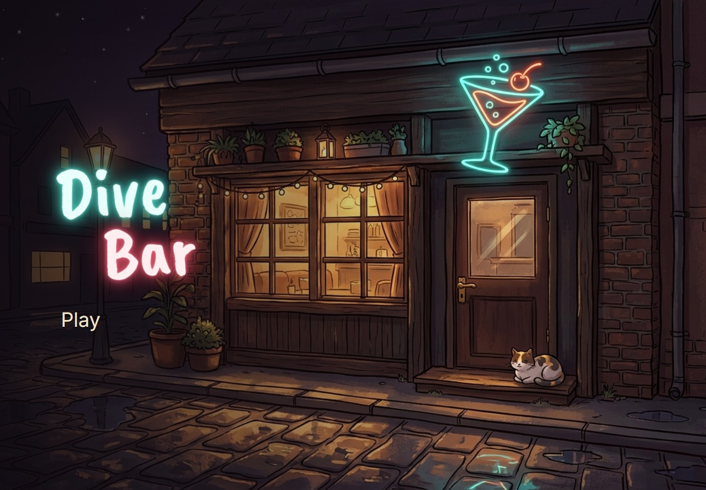
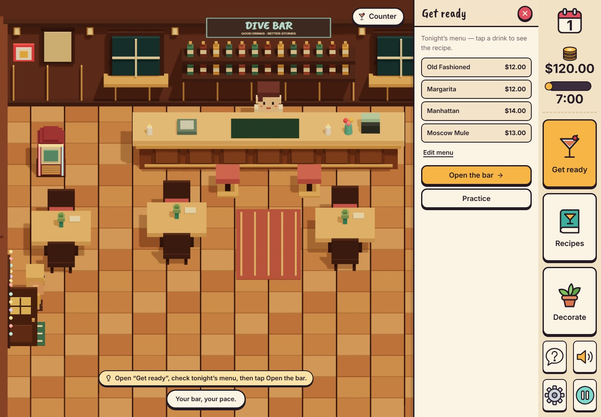
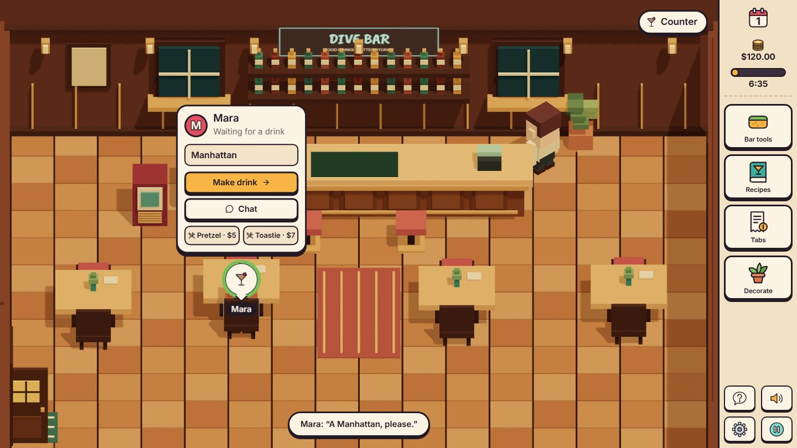
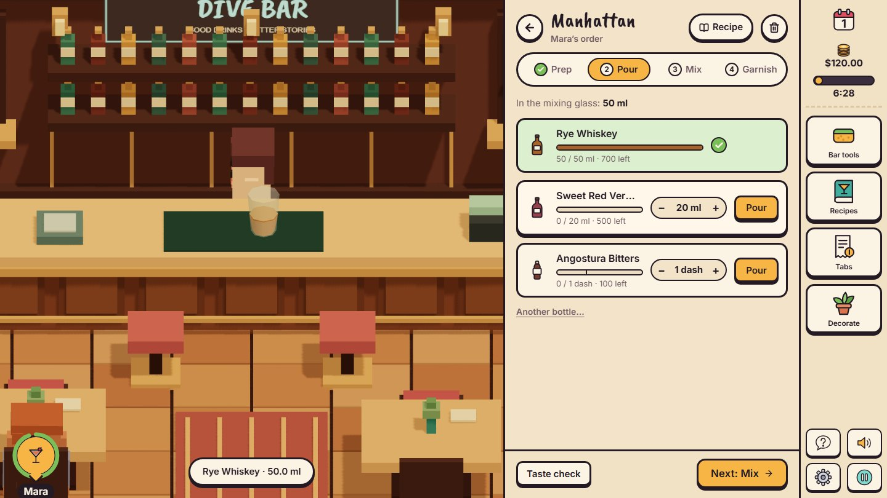
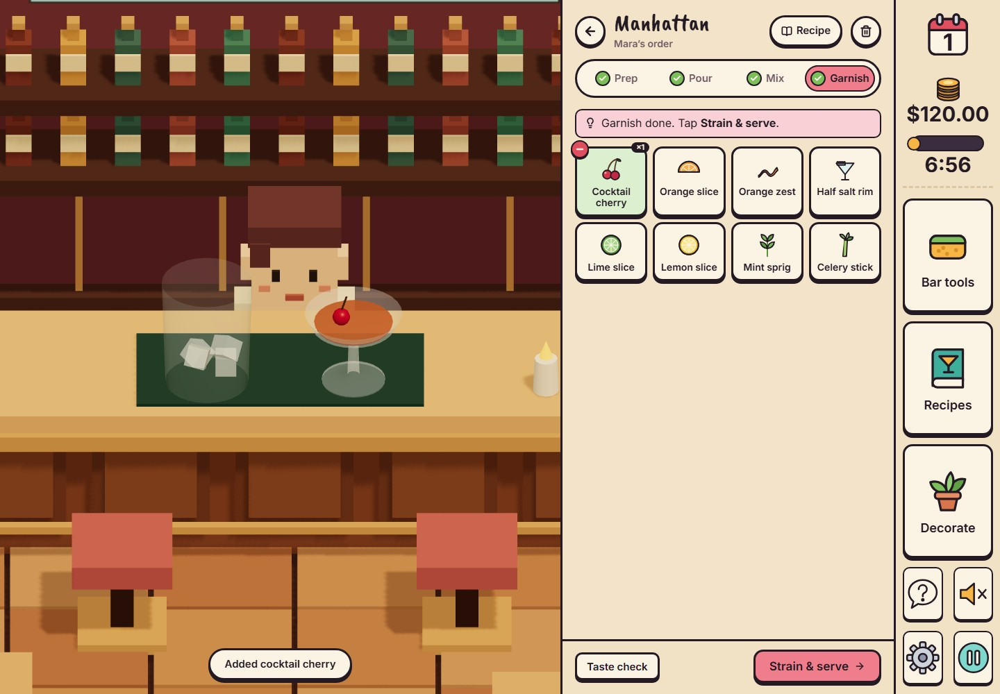
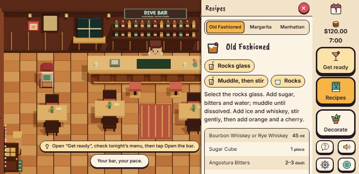

# Dive Bar

A small voxel neighbourhood bar. Real measures, familiar faces, and the occasional little white lie.

**Play it:** https://gestusition.github.io/dive-bar/ · **Latest release:** [v0.0.1](https://github.com/Gestusition/dive-bar/releases/tag/v0.0.1)



## Screenshots

| Getting ready for the night                         | Guests show what they need                             |
| --------------------------------------------------- | ------------------------------------------------------ |
|  |  |
| **Pouring a Manhattan, one bottle at a time**       | **Finishing it off at the Garnish step**               |
|      |   |

On a phone held sideways (Galaxy S8+, 740 x 360):



## How to play

1. Tap **Get ready** on the side rail. Check tonight's menu, practise if you like, then **Open the bar**.
2. Guests walk in through the front door, on their own or in pairs; the door bell tells you. Tap their bubble and **Seat guest**. Pairs share a table.
3. When their bubble shows **?**, take the order. **Chat** if they have something to say.
4. Tap **Make drink** and work through the counter's four steps:
   - **Prep:** pick what to build the drink in and the glass to serve it in.
   - **Pour:** each ingredient in the recipe has its own row; set the amount and tap **Pour**. Where sugar must dissolve first, hold **Muddle** before the spirit goes in.
   - **Mix:** add ice, then hold **Shake** or **Stir** and let go while the meter is green.
   - **Garnish:** finish it off (the minus takes one off again), then **Strain & serve**.
   - The drink builds up on the counter as you go, and bartending hints point at the next step (switch them off in Settings).
5. Let them enjoy it, then settle up. Friends say whether they want one bill or to split it; listen, it shows in the tip. The tip pops up over the guest as they pay.
6. Call **Last orders** from **Bar tools**. At closing time wipe, empty the trash, restock and wash glasses, then close the bar.
7. Between nights, decorate the bar. Decor lifts tips; the host seats guests for you.

A step is ticked only when it is really done. Pours count within 40% of the target; the **Taste check** scores the fine detail.

Escape closes a drawer or window, or pauses. Windows pause service. The pause menu can save and return to the title, where **Continue** picks up the night.

## What is in the game

**The bar**

- React 19 and React Three Fiber 9 / Three.js voxel room and characters, framed straight on and filling the screen.
- Four tables and a front door; guests plan paths around the furniture on the way in and out.
- Decor themes that change the room, and decor with real effects: jukebox music, door lights that draw guests in, counter candles, wall prints, a plant and neon, plus a host who seats guests at the door.

**The interface**

- A compact side rail for the night, cash and time, with tiles that slide out drawers: Get ready / Bar tools / Closing, Recipes and Decorate.
- Speech bubbles over guests show what they need; tap one for its action card.
- Illustrated icons for drinks, glassware, bottles, garnishes and bar tools, drawn in each drink's real colour.
- Neon-sign title screen, hand-lettered headings (Caveat Brush) and Inter body text.
- Keyboard-accessible controls and a reduced-motion setting.

**Drinks**

- Fourteen classic, regional and clearly labelled house recipes; pick up to six for a night.
- A step-by-step counter (Prep, Pour, Mix, Garnish) with measured or free pouring and native dash, piece and spoon units.
- Recipe quantity, proportion, yield and technique scoring, with taste notes that name the bottles.
- Real stock use and waste; a separate unlimited practice bench with an in-game drink picker.

**Service**

- Guest arrival, seating, menu reading, orders, preparation, drinking, tabs, payment and last call.
- Warm pretzels and cheese toasties with one warming slot, snack stock and charges.
- Pairs who pay together and ask for one bill or a split, integer money, idempotent settlement, and tips that follow the drink's score, the conversation, how fast it came and the room.
- Guests choose from the whole menu and can turn your suggestions down; every night is shuffled with fresh randomness.
- Authored English conversations, plausible sweet lies, saved rapport and story callbacks.
- Cleaning, washing, trash, editable restocking, ice refills and a closing recap.
- Bar sounds built from the real thing (door bell, till, pour, ice, shaker, glass on wood). Drop a recording into `public/sounds/<name>.mp3` (`door`, `register`, `coin`, `pour`, `ice`, `shake`, `stir`, `muddle`, `glass`, `garnish`, `page`) to replace one.

**Phones**

- Played in landscape. Phones held upright are asked to turn sideways, and Android locks to landscape on Play.
- Everything fits without scrolling from a Galaxy S8+ (360 px tall) upwards, and on iPhones on their side.

**Saving**

- IndexedDB saves, and backups as a compressed, checksummed `.divebar` file that refuses to load if damaged. Older JSON backups still import.

The conversation banks hold 24 encounters and 96 responses. The game picks social encounters that fit the moment; service-draft encounters stay in the source rather than appearing in the wrong situation. There is no ingredient-provenance screen or truth/lie badge.

## Play locally

Requires Node 24 and Bun 1.4.2.

```sh
bun install --frozen-lockfile
bun run dev
```

Build and preview the exact static application:

```sh
bun run build
bun run preview
```

## Checks

```sh
bun run validate:content
bun run format:check
bun run lint
bun run typecheck
bun run test:unit
bun run build
bunx playwright install chromium firefox webkit
bun run test:e2e
```

Vitest is the unit runner; use `bun run test:unit` rather than `bun test`. Playwright tests the production build in Firefox, Chrome, a Galaxy S8 in landscape (Chromium) and an iPhone 13 in landscape (WebKit). Emulation is not a physical-phone performance certification.

## Delivery

`.github/workflows/ci.yml` checks pull requests and `main`, then deploys the same tested build to GitHub Pages from `main`. Dependabot keeps Bun and Actions dependencies up to date without auto-merge.

The site is a static Next.js export, with Turbopack for development and production builds. GitHub Pages uses the `/dive-bar` base path; local development and preview use the root path. TypeScript 7 supplies the native `tsc`, while the `typescript` package aliases `@typescript/typescript6` for lint tools that still need its API, following [Microsoft's side-by-side migration](https://devblogs.microsoft.com/typescript/announcing-typescript-7-0/#running-side-by-side-with-typescript-6-0).

## Source map

- `src/game/engine.ts`: deterministic service, stock, money, dialogue effects and shift transitions.
- `src/game/quality.ts`: recipe and technique scoring and taste notes.
- `src/game/navigation.ts`: the bartender's counter-safe route and the guests' furniture-aware pathfinding.
- `src/game/store.ts`: React bridge, clock, action queue and saving.
- `src/game/audio.ts`: bar sounds and the jukebox.
- `src/game/storage.ts`: IndexedDB and save validation.
- `src/view/BarScene.tsx`: voxel geometry, scene, actors, camera and guest bubbles.
- `src/ui/App.tsx`: title screen, side rail and drawers, windows and the pause menu.
- `src/ui/Station.tsx` and `src/ui/bench.css`: the step-by-step counter.
- `src/ui/GuestActions.tsx`: the action card over a guest.
- `src/ui/Management.tsx`: tonight's menu, restocking and tabs.
- `src/ui/art.tsx`: the illustrated icons.
- `data/cocktails.en.json`: original IBA recipe seeds.
- `data/catalogue.en.json`: researched expansion and declared house variations.
- `docs/recipe-research.md`: interpretations of uncertain names and recipe sources.
- `docs/implementation-status.md`: verified behaviour and remaining validation limits.

The supplied artwork in `public/assets` and `art-src` is preserved. Voxel geometry is authored in code. Caveat Brush and Inter are self-hosted via Fontsource under the SIL Open Font License; the licence notices ship in `public/licenses`.
