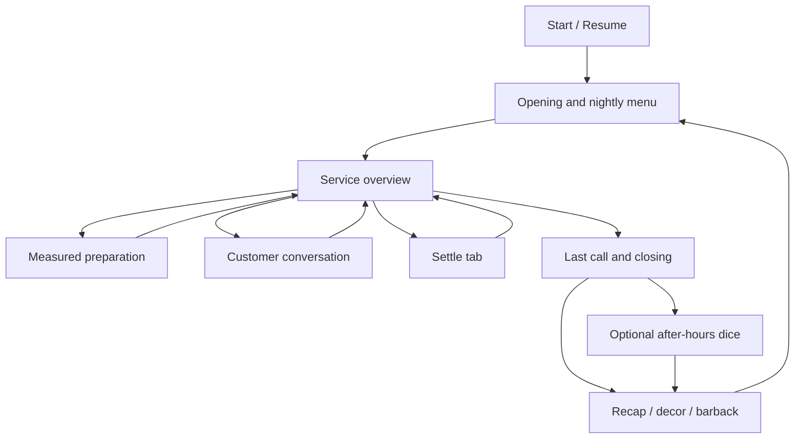
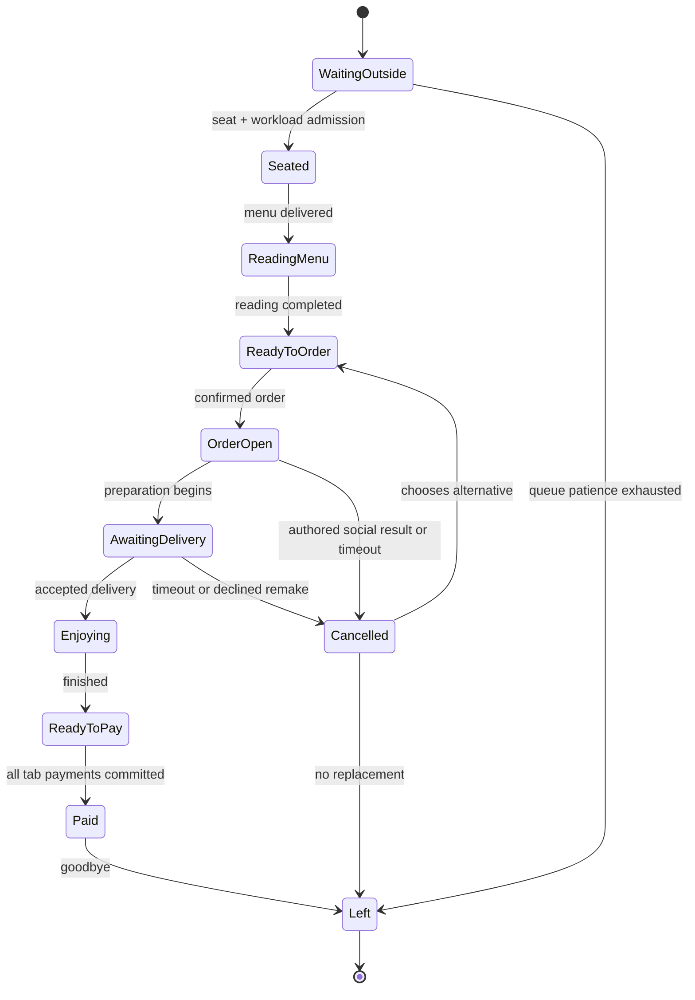
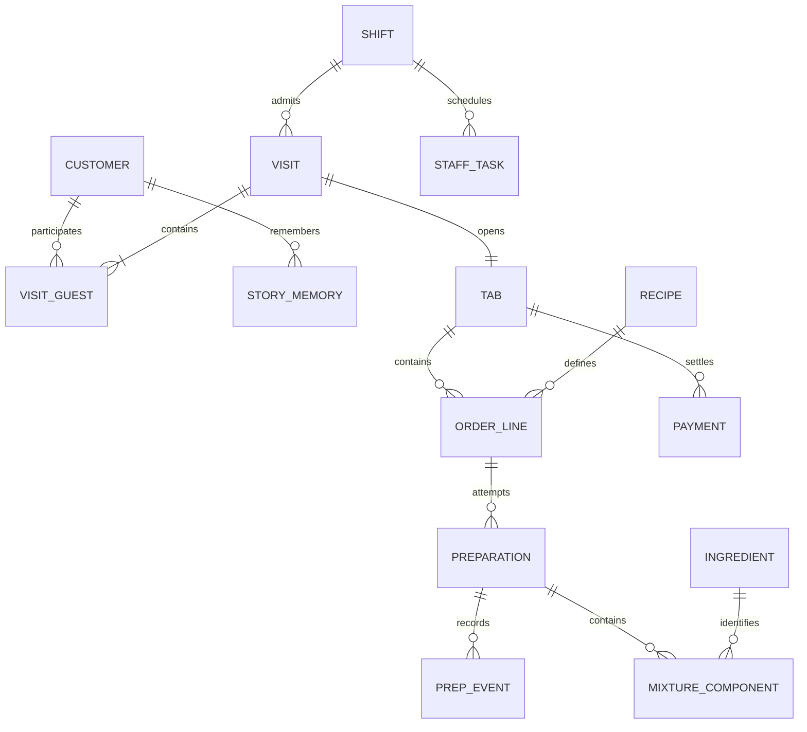
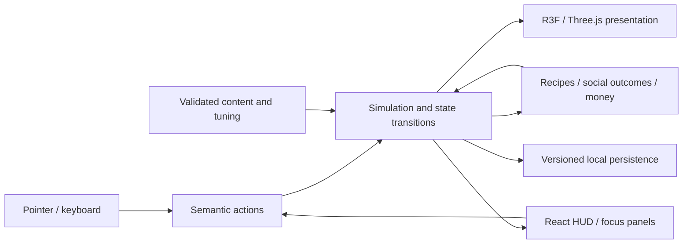

# System design and schemas

Revision: 24 October 2026. Contracts and diagrams only; no runtime exists. Resolved implementation details in docs/development-handoff.md and docs/gameplay-contracts.md supersede earlier broad wording. data/vertical-slice.en.json is the enabled-content registry.

## Game and screen flow

## Customer lifecycle

Dialogue is an overlay on a saved customer state, not a reset of the lifecycle. Cancellation is scoped to the affected order. A pre-existing paid item remains paid.

The lifecycle diagram follows one VisitGuest after a party has been admitted. Outside waiting is shared by the party; each admitted guest then has independent reading, order and consumption progress. The group tab aggregates charges without forcing all guests into the same state.

## Core data relationships

## Minimal state contracts
- Customer: id, displayName, usualRecipeId, preferences, rapport, encounterHistory, storyMemory.
- Visit: id, visitGuestIds, seatIds, derivedLifecycleState, pendingDialogueId.
- VisitGuest: id, visitId, customerId, seatId, lifecycleState, stateRemainingServiceTime. A group visit contains one or more independently served guests.
- OrderLine: id, tabId, guestId, baseRecipeId, acceptedVariant, revision, status, reservedPreparationId.
- Preparation: id, orderLineId or null, orderRevision, vesselStates, eventLog, qualityBreakdown, servedAt or null.
- Vessel: id, capacityMl, measuredLiquidComponents, discreteIngredients, iceState, temperatureProxy, dissolvedSugar, garnish.
- IngredientQuantity: ingredientId, amount, unit. Units ml/dash/piece remain distinct. Source dash amounts are not silently converted.
- StoryMemory: customerId, subjectKey, currentStoryId, history, shiftTold. The latest story controls callbacks; older entries remain history. This is remembered conversation, not ingredient provenance.
- Tab: id, visitId, itemSnapshots, paidAmountMinor, status. Prices use integer minor currency units.
- Payment: transactionId, tabId, amountMinor, method, committedAt. No real payment integration.
- Inventory: ingredient quantities by unit, ice units, clean/dirty glasses, waste capacity, reserved stock.
- StaffTask: id, assigneeId, action, destinationId, claimedResources, status, priority.
- Save: schemaVersion, contentVersion, sessionId, shiftState, customerMemory, inventory, orders, preparations, payments, upgrades, settings, randomState.

Recipe definitions and dialogue definitions are content, distinct from mutable save state. Authoring-only truth metadata never renders. Public client files are not a secure secret store; the requirement is player UI presentation.

Load both data/dialogues.en.json and data/social-dialogues.en.json into one dialogue registry. Conversation IDs must be unique across banks. Use customerId for identity; customer is a display label. A choice with storyId records it under the conversation's storySubjectKey and customerId. A callback with eligibility.requiresStory is disabled unless its customerId/subjectKey/storyId matches the current saved story. The cherry callback refers to the original cherry-origin encounter's local_family_orchard story. These eligibility and memory handlers must exist before that content is enabled. No generic honesty evaluator may override authored outcomes.

Legacy encounters without kind default to service. Select the 18 vertical-slice IDs from data/vertical-slice.en.json; the other six are explicitly deferred. A content eligibility pass must also check each orderChange and terminal/world action against the implemented handler registry and active recipe catalogue. First-slice extra_cherry is supported; less-sweet variants and split_three are registered for the later systems stage. Never silently map an unknown drink to a different recipe.

## Architecture

Use plain TypeScript simulation modules with narrow interfaces. React Three Fiber/Three.js presents state; React DOM UI dispatches actions, styled with Tailwind v4 and selective themed shadcn components. A small Zustand bridge publishes selected UI snapshots; per-frame simulation and animation stay outside broad React subscriptions. Start with explicit controllers, not a custom general-purpose engine or mandatory ECS. No physics dependency until a concrete interaction requires it. Scripted stool animation suffices. docs/technology-and-delivery.md defines the selected toolchain and tests.

## Time and input invariants
One service clock scales guest timers, arrivals, and dialogue cooldown. Real interaction time drives responsive pouring and short technique actions. When globally paused, neither advances. Tab time is never used to backfill simulated work.

A held gesture has an owner pointer and cancellation token. On every focus/pause transition, cancel it. Resume requires a new deliberate gesture.

The selected target, destination, interaction range, order revision, available stock, and capacity are checked again when an action commits. Pathfinding completion alone cannot authorize a stale serve.

Two pending player tasks maximum. Staff tasks use claims so the bartender and barback cannot both consume the same bottle refill or clear the same glass.

## Transaction invariants
1. Transfer conserves each liquid component minus explicit spill; discrete items remain separate.
2. Inventory is deducted once when consumed. Reservations are not consumption. Each order has many historical attempts and at most one active attempt.
3. Discarded mixtures do not restore stock.
4. Serving commits once and links an item to exactly one order line.
5. A recipe modifier accepted after a preparation starts increments order revision; require explicit rebuild/reassignment before service. Never silently rescore an old preparation against a new target.
6. Cancellation releases reservations and refunds prepayment as applicable; consumed ingredients remain consumed.
7. Partial payments must sum to the tab total. Rounding goes to the last split; duplicate transaction IDs do not charge again.
8. Optional garnish is not a hidden mandatory requirement.
9. A social story changes rapport/story memory, not ingredients, prices, or recipe quantities.
10. Failed save writes keep the last known good snapshot and report failure.

## Persistence and delivery
IndexedDB with explicit schema/content migrations; small settings can use local storage. Snapshot after safe committed actions and at shift boundaries, with debouncing. Do not rely on unload to save. Export/import validates version and structure before replacing a save.

Build static assets with Vite, correct repository base, and GitHub Actions Pages deployment. No server-only routes or secrets. First launch requires network; offline caching is deferred until asset versioning is reliable. Cross-device save transfer is manual import/export at launch.

## Proof before scale
Verify state transitions, unit conservation, idempotent payments/serves, story prerequisites, capacity admission, gesture cancellation, pause/resume, save migrations, and corrupt-save recovery once runtime exists.

Content-only checks at this stage cannot validate animations, pathfinding, mobile feel, game balance, or performance.

